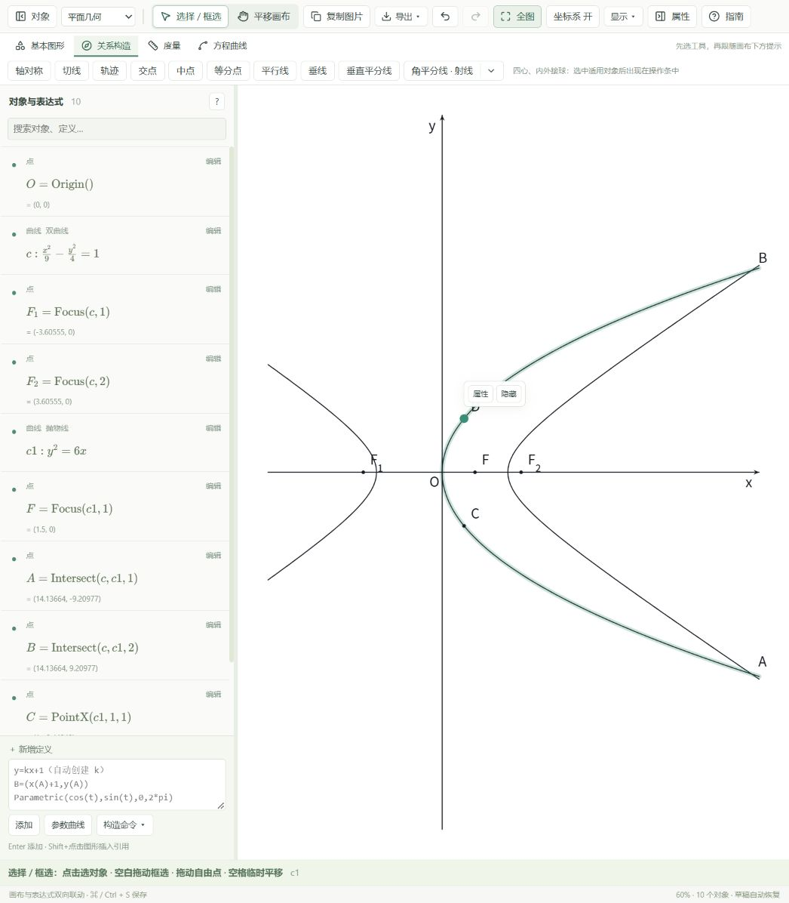

# 切线与交点修复验证（2026-10-20）

以下 0.1.0 打包信息为历史记录；最新 0.1.1 的坐标系修复与打开说明见 [右手坐标系验证](right-handed-axes.md)。

## 原因与修改

- 原切线算法对非圆曲线在主线程执行 25×25 个起点、每个最多 45 次的二维牛顿搜索。圆、椭圆、抛物线、双曲线及直线现在从方程提取二次系数，使用极线与二次方程直接计算切点，覆盖旋转、平移和显示区域外的切点。两条切线在曲线上合并时保留有效关联。
- 原交点算法仅搜索对象保存的 `[-5,5]²`，即使曲线已跟随视图显示在范围外。默认双曲线 `x²/9−y²/4=1` 与抛物线 `y²=6x` 的两个交点约为 `(14.13664,±9.20977)`。二次曲线现在通过消元多项式求全局实根，同时遵守用户固定的范围和限制条件。
- 移除创建 100 个试探交点的流程，直接从共享的几何求解器取得交点数量。成功和失败都按对象对缓存；切线结果也使用有容量限制的缓存。
- 切线作为直线直接裁剪成一段，不再使用隐式曲线网格采样。指针移动每帧只处理最新位置；拖动使用低分辨率采样，松手恢复完整精度。
- 两个对象选择完毕即创建全部交点；指定横/纵坐标输入后直接创建全部候选点；坐标系选择 y 正方向后直接完成。需要输入数值、选择高度或多边形终点的操作仍保留完成输入的动作。

## 检查结果

- `vitest run`：13 个测试文件、249 项测试通过，其中新增 35 项覆盖切线、交点、求解时限和连续拖动。
- `tsc --noEmit`：通过。
- Vite 生产构建：通过。
- Windows x64 正式版：2026-10-20 已完成 MSVC release 编译与 NSIS 打包，产品版本 0.1.0。安装包和独立程序的版本信息、PE 架构及 SHA-256 与构建清单核对通过；本轮未安装或启动桌面程序。

打包文件位于项目根目录 `artifacts/mathdraw/windows/`：

- `Mathdraw_0.1.0_x64-setup.exe`：5,526,458 字节，SHA-256 `8F72405B224CE6BAC4FA8540A721900D1FA0B05C7BA52B42200D13A220CB3607`。
- `mathdraw.exe`：18,174,464 字节，SHA-256 `AB5587934733AE25B536FB3C3F19746229EE16B732AE96C07CFCB3E97975B3A6`。
- `build-info.json`：构建时间、目标平台与校验清单。
- 240 个连续椭圆外部点位置：始终解析出两条有效切线，没有进入数值搜索。
- 真实浏览器页面：依次选默认双曲线和抛物线立即产生 A、B；指定横坐标 1 提交后立即产生 `(1,±√6)` 两点，无额外预览确认。
- 真实浏览器拖动抛物线切线经过点：有效区域内两条切线随点更新；进入无实切线区域显示失效，拖回后恢复。
- 真实浏览器空间坐标系：选原点、x 方向、底面，切换左手系后选 y 方向，立即显示坐标轴且退出构造，没有第 5 步确认。

## 浏览器复查入口

运行项目 Vite 开发服务后打开 `/verification/drawing.html?drawing&standalone`。此入口加载实际应用，只模拟 Tauri 文件、字体和窗口接口，不读写桌面文件；不包含在生产构建入口中。

任意自定义函数及参数曲线仍使用有限范围的数值搜索。交互中的数值求解采用 12 毫秒的协作式时限，超时会报告求解超时，不当作已证明没有解；不能据此保证任意复杂表达式都能在一帧内完成或穷尽所有实根。
