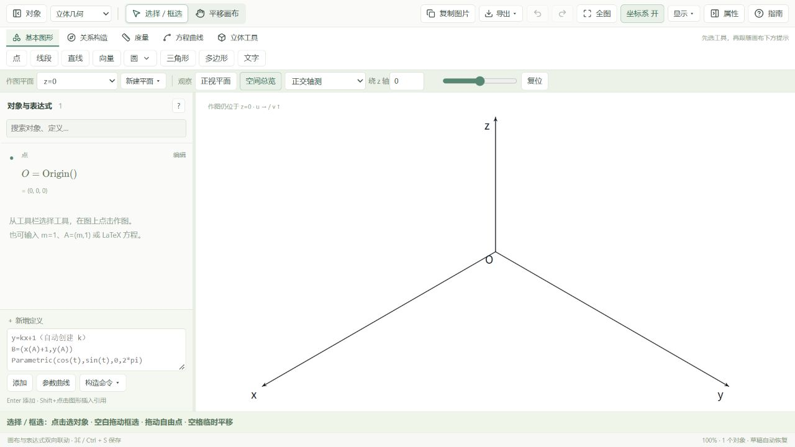
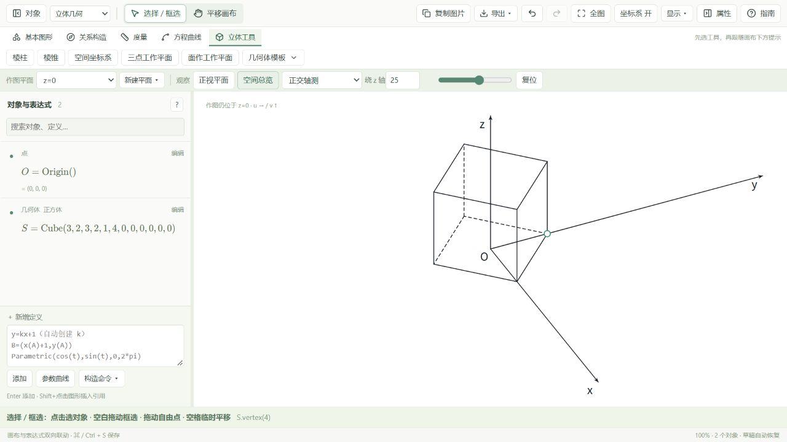

# Mathdraw 0.1.1：右手坐标系修复

## 修改

默认正交轴测的屏幕横坐标由 `(x-y)/√2` 修正为 `(y-x)/√2`。屏幕向右与向上的基向量的叉乘现在指向观察者，和用于遮挡判断的 `viewRay` 一致；初始画面为 x 左下、y 右下、z 向上。

手动建系共用 `frameFromDirections` 计算预览和提交结果：按所选 y 半平面正交化，默认 `z=x×y`，检查重合、共线和离面输入；仍保留明确选择左手系的兼容选项。选择 xOy 面时仅选面，坐标轴、直边和点标签不会抢先被选中。选择 y 方向后直接完成。

## 验证

- 14 个测试文件、260 项测试通过；新增 11 项右手方向与手动建系测试。
- 两种空间投影、多种旋转角度下，屏幕基向量与观察方向一致。
- 倾斜工作平面的拖动反算、手动轴关联点、保存恢复均通过。
- 真实浏览器验证默认三轴方向；手动建系默认选右手系，选完 y 方向即完成；坐标轴覆盖处可以选择底面，完成后继续旋转观察正常。
- Windows 打包在同一源码目录执行 `scripts/build-mathdraw-windows.ps1 -SkipInstall`；最终输出版本为 0.1.1。

## 打开新版

先保存并关闭正在运行的旧版。打开 `D:\mathdraw\Mathdraw-0.1.1`，双击 `mathdraw.exe` 即可，不需要启动开发服务。若需要安装到系统，双击同目录的 `Mathdraw_0.1.1_x64-setup.exe`，安装完成后从开始菜单打开 Mathdraw。

手动建系入口为“立体工具 → 空间坐标系”。保持“右手系：z=x×y”，依次选原点、x 正方向、xOy 面、y 正方向。

