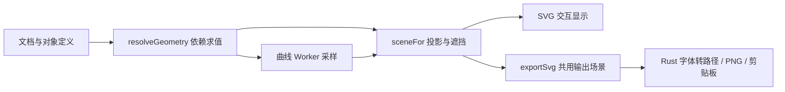

# Mathdraw 代码结构与数据流

核对日期：2026-10-24。路径均相对于工作区 `ChuanAILab/`；下表省略共同前缀时会特别说明。

## 1. 两个应用共用源工程

- `枝间/src/main.tsx`：按 URL 参数进入笔记或绘图界面，绘图组件懒加载。
- `枝间/src/App.tsx`：笔记应用。不要因为目录叫“枝间”就将所有文件误判为笔记业务。
- `枝间/src/drawing/DrawingApp.tsx`：绘图文件、文档状态、撤销、恢复、字体、导出及退出协调。
- `枝间/src-tauri/tauri.conf.json`：Mindgrove 基础配置和共同版本。
- `枝间/src-tauri/tauri.drawing.conf.json`：覆盖产品名、标识、窗口和更新源，构建独立 Mathdraw。
- 独立产品标识为 `lab.chuan.mathdraw`，窗口 label 为 `drawing`，URL 带 `drawing=1&standalone=1`。
- Rust 的 `drawing_standalone()` 判断产品标识，前端也使用 URL 标记；隔离测试更换标识后，部分原生菜单行为不会完全等同正式独立版。

## 2. 界面与交互

以下文件在 `枝间/src/drawing/`：

| 文件 | 主要职责 |
| --- | --- |
| `DrawingApp.tsx` | `doc/docRef`、文件哈希、恢复队列、草稿、提交、undo/redo、输出、标题、更新协调 |
| `DrawingWorkbench.tsx` | 画布鼠标/键盘事件、选择、拖动、工具流程、侧栏与模态窗口接线 |
| `ToolBar.tsx`、`controls.tsx` | 工具分组、按钮和常用控件 |
| `interaction.ts` | `ToolState`、分步作图、候选拾取、吸附、未完成对象预览 |
| `ExpressionPanel.tsx` | 对象/表达式行、双击源码编辑、属性、参数滑块、列表过滤 |
| `objectTree.ts` | 条件体系下的点/线/面/轨迹/其他层级和依赖归属 |
| `ConditionInput.tsx`、`ShapeDeclaration.tsx`、`ConstraintCurves.tsx` | 条件完整/简写输入、声明图形、声明圆/椭圆 |
| `ConstraintWorkbench.tsx` | 空间条件工作区、预览、结果、放置确认 |
| `PlanarConstraintWorkbench.tsx`、`PlanarObjectForm.tsx` | 平面两模式、导入定义、已知/待求设置 |
| `ConstraintSetControls.tsx` | 构型、动点、固定参照、手性、轨迹控制与精确状态展示 |
| `ColorPalette.tsx`、`colors.ts` | 预设/自定义/已使用颜色 |
| `drawing.css`、`workbench.css`、`constraints.css` | 主界面、工作区、条件输入样式 |

界面编辑统一调用 `DrawingChange`，不要直接修改传入对象或只修改 SVG。`DrawingApp` 的提交逻辑会校验/规范化文档并维护历史；连续拖动应合并历史，避免每个指针事件都产生撤销步。

## 3. 定义、依赖与几何计算

| 文件 | 主要职责 |
| --- | --- |
| `types.ts` | 文档、对象、构造、样式、视角、输出、文件适配器类型与默认值 |
| `input.ts` | 定义和构造命令输入规范化，文字参数等 |
| `expression.ts`、`latex.ts` | 受限表达式 AST、数值计算、LaTeX 转换；不使用 JS eval |
| `symbols.ts`、`parameters.ts` | 独立符号、数值对象、自动变量、参数表达式、坐标引用 |
| `model.ts` | 创建/编辑定义、重命名、依赖删除、规范化和构造命令入口 |
| `geometry.ts` | 文档校验、依赖解析、缓存、派生几何、投影/反投影 |
| `constructions.ts`、`advanced.ts` | 四心、等分、求交、反射、切线等构造 |
| `spatial.ts`、`axes.ts` | 几何体、空间坐标系及可引用的隐藏坐标轴对象 |
| `polyhedra.ts` | 面壳拓扑、闭合成体、独立面与所属几何体的关系 |
| `fold.ts` | 多边形翻折和角变量联动 |
| `conics.ts`、`quadratic.ts`、`parametric.ts` | 圆锥曲线特征、二次/多项式数值求交、参数曲线 |
| `annotation.ts`、`angleMark.ts`、`vectorCoordinates.ts` | 文字、角弧/半径与角名选项、向量坐标 |
| `exactNumber.ts`、`constraints/exactDisplay.ts` | 数值显示和已保存精确表达；不能把小数猜根式当成证明 |

### 文档对象的关键字段

- `DrawingDocument`：文档 ID、`schemaVersion`、`dimension`、`objects`、工作平面、视角、边样式、坐标框架与导出范围。
- `GeometryObject`：联合类型，包含 point、segment/vector/line、triangle、polygon、curve、solid、label、number、solutionSet、spatialLocus。
- `id`：持久化引用身份；`symbol`：表达式独立符号；`name`：显示标签。重命名不能重建 ID。
- `PointConstruction`：自由点、原点、线上点、交点、定比分点、四心、反射、旋转、条件点等显式依赖。
- `parameters`：参数源码、符号到对象 ID 的映射及字段表达式。
- `constraintSet` / `constraintPointName`：条件体系归属与原点名；不能因对象呈现为普通点而绕过其条件绑定。
- `body` / `constraintFace`：几何体归属及条件面身份，隐藏列表中的面不等于删除遮挡面。

空间数据始终是实际 `Vec3`。工作平面是 `origin/u/v` 局部基；`DrawingView` 描述观察方式；`coordinateFrame` 是用户建立的坐标轴。**换视角、选工作平面、建立坐标系是三类操作**，不能相互混写。

## 4. 场景、采样与输出

- `useCurveSampler.ts` + `curve.worker.ts` + `curves.ts`：后台曲线采样、移动期间与稳定后的采样策略；改滑块性能应从这里及依赖失效链检查。
- `scene.ts`：统一 paths/texts/dots；空间视线与三角面求交后分段显示实线/虚线，生成共用导出场景。
- `viewport.ts`：绘图区白边、裁切与取景。无限直线不应将“全图”边界拉到采样端点。
- `annotation.ts` 等负责 Times New Roman 字形排布，普通 KaTeX 界面预览不等于导出字体实现。
- 选中高亮、编辑手柄、吸附提示、工作平面提示是交互辅助，不得进入输出。

## 5. 两套轨迹

| 类型 | 相关文件 | 含义 |
| --- | --- | --- |
| 普通构造轨迹 | `locus.ts`、`implicitLocus.ts`、`locusAlgebra.ts` | 根据主动点的允许参数和从动点依赖计算轨迹；能消参时显示非参数方程 |
| 轨迹反向拖动 | `locusDrag.ts`、`pathProjection.ts` | 由从动点目标反推主动点参数；保持原分支，局部投影失败不代表源曲线永久失效 |
| 条件体系轨迹 | `constraints/loci.ts`、`solver.ts`、`document.ts` | 同时满足全组条件的轨迹或经验证样本，依赖 solutionSet |

不要拿一条条件导出的候选圆/球冒充全条件体系的可行轨迹。`displayableLocus()` 对不完整解析候选与已验证的数值样本有不同处理。

## 6. 原生层与持久化

| 位置 | 职责 |
| --- | --- |
| `枝间/src/drawing/adapter.ts` | Rust invoke 的前端适配器 |
| `枝间/src-tauri/src/drawing.rs` | 原生打开/保存、哈希冲突保护、恢复、字体加载检查、SVG/PNG/剪贴板输出、条件配置文件 |
| `枝间/src-tauri/src/lib.rs` | 菜单、窗口、退出协调、IPC 注册、更新检查与重启 |
| `枝间/src-tauri/src/vault.rs` | 笔记库与原子写入等公用能力；涉及笔记时注意回归范围 |
| `枝间/src-tauri/capabilities/` | 窗口权限声明；新增 invoke/插件能力时一起核对 |

绘图源文件是 `.mathdraw.json`，当前写入 v4，读取兼容旧版。条件配置为 `.mathdraw-conditions.json`，当前 v2；v1 保持旧空间语义。源文件上限 8 MiB；加载必须校验版本、引用、数值、依赖及解集信息。

恢复数据位于 Tauri `app_config_dir()/drawing/`，其中 `recovery.json` 保存文档和草稿。实际绝对路径由系统及产品标识决定，不硬编码某个测试应用的目录。

自动恢复不是自动覆盖用户源文件：打开/保存使用原生对话框授权文件，源文件保存有旧哈希检查；更新前先保留恢复草稿。未完成表达式与条件编辑输入不应伪装成已保存的有效定义。
